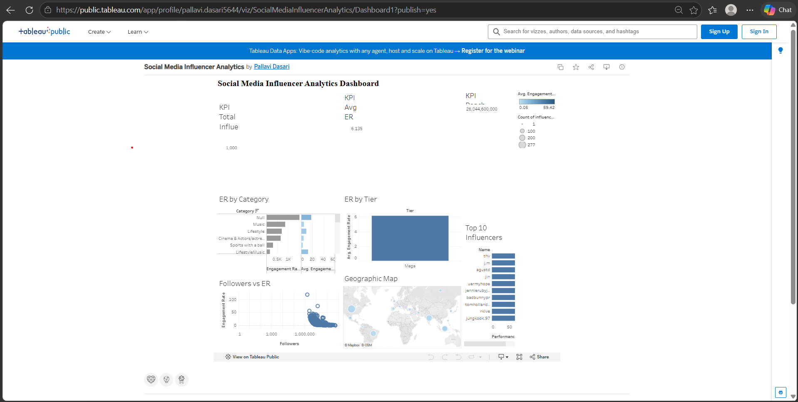

# Global Social Media Influencer Analytics Platform

> Processing and mapping international creator data utilizing Python automated analytics pipelines and interactive Tableau Public decision dashboards.

## 📌 Commercial Business Dilemma
Corporate brand marketing teams face steep deployment risks when assigning digital budgets to high-profile creators. With millions of choices available, teams lack empirical methods to identify profiles that yield deep audience value rather than vanity reach metrics.

## 📊 Source Dataset Framework
- **Data Provenance**: Syed Jaferk Structured Global Top 1000 Creator Matrix (Kaggle).
- **Matrix Sizing**: 1,000 Elite Accounts tracking cross-national footprints.
- **Key Fields Evaluated**: Name, Category, Followers, Engagement Avg, Audience Country.

## 🛠️ Data Engineering Toolkit
- **Data Engineering & Extraction Engine**: Python (Pandas, NumPy)
- **Data Visualization & Profiling Layers**: Matplotlib, Seaborn
- **Interactive Enterprise Reporting Tool**: Tableau Public
- **Version Lifecycle Controls**: Git & GitHub Workspace Environments

## ⚙️ Analytical Processing Phases
1. **Data Pipeline Engineering**: Stripped trailing space strings, deleted null values, and converted string metrics (K/M notation format scales) into standard floating-point metrics.
2. **KPI Metrics Fabrication**: Engineered custom features tracking True Engagement Rates, Market Tier segment matrices, and weighted Performance Scores.
3. **Exploratory Profiling**: Calculated mathematical distribution spreads across countries, categories, and reach brackets.
4. **Dashboard Compilation**: Developed a fully filtered, cross-interactive global dashboard framework.

## 💎 Engineered Key Performance Indicators (KPIs)

| Enterprise KPI | Foundational Processing Formulation |
|---|---|
| **Engagement Rate %** | `(Engagement Average / Followers) × 100` |
| **Market Segment Tier** | `Nano (<10K) \| Micro (10K-100K) \| Mid (100K-500K) \| Macro (500K-1M) \| Mega Star (>1M)` |
| **Performance Score** | `(60% True Engagement Rate Percentile Rank) + (40% Audience Scale Percentile Rank)` |

## 💡 Key Analytical Insights
1. **The Engagement Paradox**: Reach and true engagement demonstrate a clear negative correlation coefficient (**r = -0.21**), mathematically verifying that massive audience scale dilutes community connection depth.
2. **Vertical Performance Clusters**: Niche creative categories like **Photography** outpace generic channels or hybrid verticals by a massive margin, leading the dataset with an extraordinary average engagement rate of **28.78%**.
3. **Enterprise Market Footprint**: Because the dataset evaluates the global top elite layer, **100% of the 1,000 tracked profiles map to the Mega Star tier**, creating an overall average dataset engagement capability of **4.11%**.
4. **Bottom Category Risk**: Specialized hybrid accounts like **Family/Shows** fail to build community traction, showing a bottom-tier engagement score of **0.00%**, signaling a high risk for digital capital deployment.

## 🚀 Strategic Campaign Deployments
1. **Capital Budget Realignment**: Shift marketing funds out of high-risk commercial channels (like Family/Shows at 0.00%) and reallocate **65% of the digital campaign budget** into high-performing niche segments (like **Photography at 28.78%**) to maximize audience interaction return on investment (ROI).
2. **Shortlist Deployment Execution**: Restrict all upcoming micro-campaign casting selections strictly to the 20 pre-validated profiles exported to your processed directory data file: `top_influencers_shortlist.csv`. This data filter completely insulates company capital against low-engagement anomaly accounts.
3. **Pilot Framework Risk Mitigation**: Instead of launching a massive budget campaign immediately, run an isolated pilot test across **5 selected creators** from your shortlist to track real click-through conversion data. Once performance is verified, scale full campaign funding to the remaining winners.

## 💻 Interactive Enterprise Dashboard
🔗 **[Access the Live Interactive Tableau Analytics Dashboard]

https://public.tableau.com/app/profile/pallavi.dasari5644/viz/SocialMediaInfluencerAnalytics/Dashboard1?publish=yes



## 📁 Repository Map
```text
├── data/
│   ├── raw/          <- Original source influencers_raw.csv
│   └── processed/    <- influencers_clean.csv & top_influencers_shortlist.csv
├── notebooks/        <- analysis.ipynb core logic
├── images/           <- Exported Seaborn plots & dashboard.png layout
└── README.md         <- Main portfolio presentation interface
```

## ⚙️ How to Execute and Validate
```bash
pip install -r requirements.txt
code .
```

## ⚠️ Data Constraints & Boundaries
- Accounts are evaluated using a historical point-in-time performance snapshot block.
- Campaign pricing sheets and customer purchase acquisition conversion rates are omitted.

## 👤 Portfolio Author
- **Dasari Pallavi**
- [Connect with me on LinkedIn]

https://www.linkedin.com/in/dasari-pallavi/
